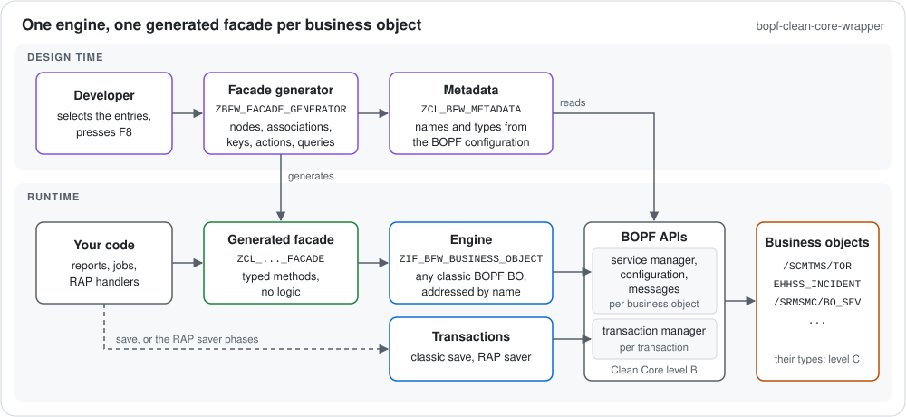

# bopf-clean-core-wrapper

A wrapper for classic BOPF business objects in ABAP. Its main purpose is to encapsulate BOPF's own APIs: the service
manager, the transaction manager (also the slave transaction manager of the RAP save sequence), the configuration, the
message container and message class, and BOPF's exceptions. Application code calls the wrapper instead.

Without it, code that works with classic BOPF business objects, such as the SAP TM transportation order
`/SCMTMS/TOR`, the EHS incident `EHHSS_INCIDENT` or the supplier evaluation `/SRMSMC/BO_SEV` of SAP Supplier Lifecycle
Management, talks to the BOPF service manager directly: node, association and action keys from constant interfaces,
generic data references, and its own handling of messages, locks and the transaction. The wrapper hides that behind
two parts:

- An **engine** that works with any classic BOPF business object. Business objects, nodes, associations, actions,
  queries and alternative keys are addressed by name and resolved at runtime from the BOPF configuration, including
  cross-BO associations and the nodes of dependent objects such as text collections.
- A **generator** that writes a typed facade class per business object for the nodes, associations and actions you
  select, e.g. `read_root( keys )` returning the node's own table type. The facade holds no logic; after an upgrade
  you generate it again.



> **Status: v1.0.0.** Tested so far on S/4HANA 2025 FPS01 (SAP_BASIS 816) with the SAP TM transportation order
> `/SCMTMS/TOR`, on ABAP Platform 2025 with the BOPF demo business object `/BOBF/DEMO_SALES_ORDER`, including the
> RAP demo, and on S/4HANA 2023 FPS01 (SAP_BASIS 758) with the BOPF demo, also including the RAP demo.

## Clean Core level B/C

The wrapper calls only classic APIs, Clean Core level B: `/BOBF/IF_TRA_SERVICE_MANAGER`,
`/BOBF/IF_TRA_TRANSACTION_MGR`, `/BOBF/IF_TRA_SLAVE_TRANS_MGR`, `/BOBF/IF_FRW_CONFIGURATION`, `/BOBF/CL_FRW_FACTORY`,
`/BOBF/IF_FRW_MESSAGE` with its messages (`/BOBF/CM_FRW`), `/BOBF/CX_FRW`, the factories of the managers and BOPF's
constants interfaces. Not classified, so level C, are only:

- the DDIC types in the signatures of these APIs, such as `/BOBF/T_FRW_KEY`, and `/BOBF/CX_FRW_CONTRCT_VIOLATION`,
  which BOPF raises when a call breaks its contract;
- the artifacts of the business object itself: its node table types (`/SCMTMS/T_TOR_ROOT_K`), which the generated
  facades necessarily build in, and its constants interfaces (`/SCMTMS/IF_TOR_C`), which the wrapper does not need,
  but callers may;
- in the generator, a development tool: the object directory `TADIR` and `RS_WORKING_OBJECTS_ACTIVATE`.

## Quick start

**You need** a system with classic BOPF and [abapGit](https://abapgit.org); tested so far on SAP_BASIS 758 and 816
(S/4HANA 2023 and 2025, and ABAP Platform 2025 for the BOPF demo).

1. **Import the ABAP objects.** In abapGit, create an online repository with the URL of this repository in a package
   of your choice, for example the local package `$ZBFW`, and pull. Or import the zip of a
   [release](https://github.com/abat-TAO/bopf-clean-core-wrapper/releases) as an offline repository.
2. **Generate a facade.** Run the report `ZBFW_FACADE_GENERATOR`: enter the facade class, the business object, the
   package and, for a transportable package, a request; then select the nodes to read and to change, the
   associations, alternative keys, actions and queries (F4 lists them). Entries are `NAME` or `NODE.NAME`, optionally
   `= alias` as the method name. The report creates and activates the class; it replaces only classes it generated
   itself. To change a facade, enter its name: the report loads its selection. Step by step, with two worked
   examples: [facade generator tutorial](docs/facade-generator.md).
3. **Call it.** The demo facade `ZCL_BFW_DEMO_SO_FACADE` for `/BOBF/DEMO_SALES_ORDER` is part of the repository:

   ```abap
   DATA(sales_orders) = NEW zcl_bfw_demo_so_facade( ).
   DATA(orders) = sales_orders->query_select_all( maximum_rows = 10 ).
   DATA(items) = sales_orders->read_items( CORRESPONDING #( orders ) ).
   ```

**Other object names.** All objects carry the code `BFW` (`ZCL_BFW_*`, `ZIF_BFW_*`, `ZCX_BFW_*`, `ZBFW_*`). If these
names are taken in your system, clone the repository and rename it from its root before the import:

```bash
node tools/rename.mjs --code XY --dry-run   # preview
node tools/rename.mjs --code XY             # ZCL_BFW_ → ZCL_XY_, ZBFW_ → ZXY_; --letter Y also changes Z → Y
```

The script renames the abapGit files and their contents and the documentation, and checks SAP's name length
limits. `--map renames.json` renames single objects. Then push your copy to your own Git repository and import it
from there, or zip it (with `.abapgit.xml` and `src/`) and import it as an offline repository.

## Usage

**Engine.** `ZCL_BFW_FACTORY=>get_business_object( name )` returns the engine for one business object
(`ZIF_BFW_BUSINESS_OBJECT`). Nodes of a dependent object are qualified with their delegated node, e.g.
`ROOT_LONG_TEXT.CONTENT`. Keys are tables of `SYSUUID_X16` (`ZIF_BFW_BUSINESS_OBJECT=>KEYS`); the rows you pass may
have any line type whose components exist in the node:

```abap
DATA items TYPE /bobf/t_demo_sales_order_itm_k.
zcl_bfw_factory=>get_business_object( `/BOBF/DEMO_SALES_ORDER` )->read_by_association(
  EXPORTING node        = `ROOT`
            association = `ITEM`
            keys        = order_keys
  IMPORTING rows        = items
            messages    = DATA(messages) ).
```

Business messages are returned, with the business object, node and key they belong to; technical errors raise
`ZCX_BFW_ACCESS` (unchecked). `FAILED_KEYS` lists what BOPF did not read or change, e.g. locked instances; a change
with a consistency error is kept by BOPF and only reported in the messages.

**Facades.** A generated facade calls the engine with the names you selected and types its methods with the
business object's own table types: `read_<node>`, `read_<node>_<association>`, `query_<query>`,
`execute_<action>`, `create_`, `update_` and `delete_<node>`; an alias replaces the name after the prefix. Paths are
followed by chaining single-hop calls, e.g. the products of the items from the quick start:

```abap
DATA(products) = sales_orders->read_item_product_root( CORRESPONDING #( items ) ).
```

**Changes and save.** Changes go into BOPF's transactional buffer; `ZCL_BFW_FACTORY=>get_transaction( )` saves or
discards all of them:

```abap
sales_orders->update_item( EXPORTING rows        = items
                           IMPORTING failed_keys = DATA(failed_keys)
                                     messages    = DATA(update_messages) ).
TRY.
    DATA(save_messages) = zcl_bfw_factory=>get_transaction( )->save( ).
  CATCH zcx_bfw_save_rejected INTO DATA(rejection).
    " BOPF rejected the save and discarded all changes; rejection->get_messages( ) tells why
ENDTRY.
```

**RAP.** An unmanaged RAP business object can implement its handlers with the engine or a facade (lock handler:
`read( ... for_update = abap_true )`). Its saver calls `ZCL_BFW_FACTORY=>get_rap_transaction( )` in each phase of
the same name, so BOPF saves in the RAP save sequence and RAP commits: `finalize`, `check_before_save`,
`adjust_numbers` (RAP calls it only with late numbering; otherwise `save` draws the numbers), `save`, `cleanup` and
`cleanup_finalize`. `REJECTED` goes into FAILED, the messages go into REPORTED with
`ZCL_BFW_RAP_MESSAGE=>from_messages( )`, which keeps BOPF's texts complete. The demo `ZBFW_R_DEMOORDER` with its
behavior pool `ZBP_BFW_R_DEMOORDER` and the console run `ZCL_BFW_RAP_DEMO_RUN` show the whole cycle.

## Known limitations

- Tested so far only on SAP_BASIS 758 and 816 (S/4HANA 2023 and 2025, ABAP Platform 2025); older releases are not
  tested yet.
- Tested business objects so far: the TM transportation order and the BOPF demo. Other classic BOPF business
  objects, e.g. of EHS or SAP Supplier Lifecycle Management, are not tested yet; issues and pull requests with
  findings are welcome.
- Callers in Standard ABAP only. ABAP for Cloud Development is not supported yet.
- RAP: only unmanaged RAP business objects without draft.
- A save can be refused only for business objects with a consistency group. The TM transportation order has one;
  the BOPF demo sales order has none, so its consistency validations only report.
- Query classes apply sorting and paging only if they implement them. BOPF's generic queries do; TM's
  `ROOT_ELEMENTS` sorts and limits the rows but ignores the start row.
- With a sorted node table type, such as TM's `_K` types, a facade's query result is in key order. For the order of
  the query, call the engine with a standard table.
- No path API: follow paths by chaining single-hop facade calls.

## Development

abaplint checks the code against `abaplint.jsonc`; ABAP Unit tests run in the SAP system. Layout, checks, tests,
demos and releases: [docs/development.md](docs/development.md).

## License

[MIT](LICENSE).
