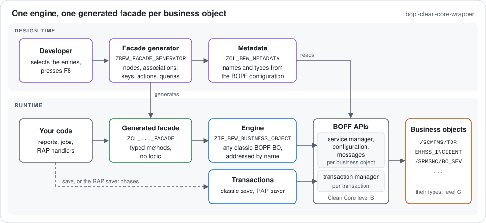

# Facade generator: tutorial

The report `ZBFW_FACADE_GENERATOR` writes a typed **facade class** for one classic BOPF business object. You select
the nodes, associations, alternative keys, actions and queries you need; the report generates one method per entry,
typed with the business object's own table types, e.g. `read_root( keys )` returning the root node's table type.

A facade holds no logic: every method only calls the engine `ZIF_BFW_BUSINESS_OBJECT` with the names you selected.
So you never edit a facade by hand. To add a method, or after an upgrade changed the business object, you change the
selection and generate the class again.



- [Before you start](#before-you-start)
- [The selection screen](#the-selection-screen)
- [Entries and the methods they generate](#entries-and-the-methods-they-generate)
- [Generate](#generate)
- [Example 1: the BOPF demo sales order](#example-1-the-bopf-demo-sales-order)
- [Example 2: the TM transportation order](#example-2-the-tm-transportation-order)
- [Change or regenerate a facade](#change-or-regenerate-a-facade)
- [Error messages](#error-messages)
- [Limits](#limits)

## Before you start

- The wrapper is imported (see the [README](../README.md#quick-start)), and you work in a development system: the
  report creates the class with the class builder and activates it.
- The business object is a **classic** BOPF business object. RAP-based and CDS-based BOPF business objects are
  refused. To browse a business object, its nodes, associations and actions, use transaction `BOBX` (or `BOB`).
- You know the package of the new class. A transportable package needs a workbench request; a local package
  (`$...`) does not.

## The selection screen

The first block names the class and where it goes:

| Field | Meaning |
| --- | --- |
| **Facade class** (required) | Name of the class to create or change, at most 30 characters, e.g. `ZCL_SO_FACADE`. Enter the name of an existing facade and press Enter to load its selection, see [Change or regenerate a facade](#change-or-regenerate-a-facade). |
| **Business object** | Name of the business object, e.g. `/BOBF/DEMO_SALES_ORDER`. |
| **Package** | Package of a new class. An existing class keeps its package. |
| **Transport request** | Workbench request for a transportable package; empty for a local package. |

The second block, "Selection: NAME or NODE.NAME, optionally = alias", holds the entries. Each select-option is one
kind of entry, one entry per line:

| Select-option | Entry | Example |
| --- | --- | --- |
| **Read nodes** | `NODE` | `ROOT` |
| **Writable nodes** | `NODE` | `ITEM` |
| **Associations** | `NODE.ASSOCIATION` | `ROOT.ITEM` |
| **Alternative keys** | `NODE.KEY` | `ROOT.ORDER_ID` |
| **Actions** | `NODE.ACTION` | `ROOT.DELIVER` |
| **Queries** | `NODE.QUERY` | `ROOT.SELECT_ALL` |

Rules for the entries:

- Names are the BOPF names; upper or lower case does not matter.
- **Nodes of a dependent object** (text collection, attachment folder, ...) are qualified with their delegated node:
  `TEXTCOLLECTION.TEXT`. The delegated node alone, e.g. `TEXTCOLLECTION`, is the root of the dependent object. An
  association from such a node puts the association name after it: `TEXTCOLLECTION.TEXT.TEXT_CONTENT`.
- **Alias:** `= alias` after the name sets the method name after its prefix: `ROOT.ITEM = items` becomes
  `read_items` instead of `read_root_item`. An alias consists of letters, digits and underscores.
- **F4 help** on every select-option lists the names of the business object entered above (no Enter needed) with an
  info column: the node table type, the target node of an association, the table type of an alternative key, the
  parameter and result types of an action, or the selection structure of a query. Choose one or several; they are
  added without duplicates and without an alias.

## Entries and the methods they generate

`<...>` stands for the entry with dots replaced by underscores, in lower case; an alias replaces it.

| Entry | Method | Parameters |
| --- | --- | --- |
| Read node `ROOT` | `read_root` | `keys`; returns the node table type |
| Writable node `ITEM` | `create_item` | changing `rows`; exporting `failed_keys`, `messages` |
| | `update_item` | `rows`, optional `changed_fields`; exporting `failed_keys`, `messages` |
| | `delete_item` | `keys`; exporting `failed_keys`, `messages` |
| Association `ROOT.ITEM` | `read_root_item` | `keys`, optional `filter` (only for an association with parameters, e.g. a language); returns the table type of the target node |
| Alternative key `ROOT.ORDER_ID` | `read_root_by_order_id` | `values` of the key's table type; returns the node table type |
| Action `ROOT.DELIVER` | `execute_deliver` | optional `keys` (empty for a static action), optional `parameters` (if the action has a parameter structure); exporting `rows` (if the action has a result), `failed_keys`, `messages` |
| Query `ROOT.SELECT_ALL` | `query_select_all` | optional `selection_parameters`, `filter_keys`, `maximum_rows`, `sorting`, `paging`; returns the node table type |

Actions and queries are named without their node. Keys are tables of type `/BOBF/T_FRW_KEY`; messages have the type
`ZIF_BFW_BUSINESS_OBJECT=>MESSAGES`. Each facade also gets a `constructor`, which takes the engine for the business
object from `ZCL_BFW_FACTORY`, and a static method `get_selection`, which returns the selection the class was
generated from.

What the parameters mean, e.g. which keys end up in `failed_keys`, is described at the methods of
`ZIF_BFW_BUSINESS_OBJECT` that the facade calls.

## Generate

Press **F8**. The report checks the selection against the business object, writes the class and activates it. The
result list shows `ZCL_SO_FACADE was generated and activated with these methods:` followed by one line per method.

If anything is wrong, it shows `ZCL_SO_FACADE: not generated or not activated` and one line per problem; see
[Error messages](#error-messages). Problems in the selection are found before anything is written.

## Example 1: the BOPF demo sales order

The repository contains the facade `ZCL_BFW_DEMO_SO_FACADE`, generated for `/BOBF/DEMO_SALES_ORDER` with this
selection:

| Select-option | Entries |
| --- | --- |
| Read nodes | `ROOT`, `ITEM`, `ROOT_TEXT`, `ROOT_LONG_TEXT.CONTENT` |
| Writable nodes | `ITEM` |
| Associations | `ROOT.ITEM = items`, `ROOT.CUSTOMER_ROOT = customers`, `ROOT.ROOT_LONG_TEXT`, `ROOT.ROOT_TEXT`, `ITEM.PRODUCT_ROOT` |
| Alternative keys | `ROOT.ORDER_ID = orders_by_id` |
| Actions | `ROOT.DELIVER`, `ROOT.ARCHIVE` |
| Queries | `ROOT.SELECT_ALL`, `ROOT.SELECT_BY_ELEMENTS` |

Some of the generated methods:

```abap
methods READ_ROOT
  importing
    !KEYS type /BOBF/T_FRW_KEY
  returning
    value(RESULT) type /BOBF/T_DEMO_SALES_ORDER_HDR_K .
methods READ_ITEMS
  importing
    !KEYS type /BOBF/T_FRW_KEY
  returning
    value(RESULT) type /BOBF/T_DEMO_SALES_ORDER_ITM_K .
methods READ_ROOT_ROOT_TEXT
  importing
    !FILTER type /BOBF/S_DEMO_LANGUAGE_CODE optional
    !KEYS type /BOBF/T_FRW_KEY
  returning
    value(RESULT) type /BOBF/T_DEMO_SHORT_TEXT_K .
methods READ_ORDERS_BY_ID
  importing
    !VALUES type /BOBF/T_DEMO_SALES_ORDER_ID
  returning
    value(RESULT) type /BOBF/T_DEMO_SALES_ORDER_HDR_K .
methods EXECUTE_DELIVER
  importing
    !KEYS type /BOBF/T_FRW_KEY optional
    !PARAMETERS type /BOBF/S_DEMO_SALES_ORDER_HDR_D optional
  exporting
    !FAILED_KEYS type /BOBF/T_FRW_KEY
    !MESSAGES type ZIF_BFW_BUSINESS_OBJECT=>MESSAGES .
methods UPDATE_ITEM
  importing
    !CHANGED_FIELDS type ZIF_BFW_BUSINESS_OBJECT=>FIELD_NAMES optional
    !ROWS type /BOBF/T_DEMO_SALES_ORDER_ITM_K
  exporting
    !FAILED_KEYS type /BOBF/T_FRW_KEY
    !MESSAGES type ZIF_BFW_BUSINESS_OBJECT=>MESSAGES .
```

`ROOT_TEXT` has a language parameter, so its association read gets the optional `filter`. Calling the facade:

```abap
DATA(sales_orders) = NEW zcl_bfw_demo_so_facade( ).
DATA(orders) = sales_orders->query_select_all( maximum_rows = 10 ).
DATA(items) = sales_orders->read_items( CORRESPONDING #( orders ) ).
" A path is followed by chaining single-hop calls: the products of these items
DATA(products) = sales_orders->read_item_product_root( CORRESPONDING #( items ) ).
DATA(english_texts) = sales_orders->read_root_root_text( keys   = CORRESPONDING #( orders )
                                                         filter = VALUE #( language = 'E' ) ).
```

Changes stay in BOPF's buffer until `ZCL_BFW_FACTORY=>get_transaction( )->save( )`; see the
[README](../README.md#usage).

## Example 2: the TM transportation order

A facade for the TM transportation order `/SCMTMS/TOR` shows the cases where an alias is needed. This selection was
generated and used on S/4HANA 2025:

| Select-option | Entries |
| --- | --- |
| Read nodes | `ROOT`, `STOP`, `TRANSPORTCHARGES`, `TEXTCOLLECTION`, `TEXTCOLLECTION.TEXT`, `TEXTCOLLECTION.TEXT_CONTENT = text_content` |
| Writable nodes | `ROOT`, `TEXTCOLLECTION`, `TEXTCOLLECTION.TEXT`, `TEXTCOLLECTION.TEXT_CONTENT = text_content` |
| Associations | `ROOT.STOP`, `ROOT.ITEM_TR_CAT_SPECIFIC`, `ROOT.TRANSPORTCHARGES`, `ROOT.BO_SFIR_ROOT`, `ROOT.TEXTCOLLECTION`, `TEXTCOLLECTION.TEXT = texts`, `TEXTCOLLECTION.TEXT.TEXT_CONTENT = text_contents`, `STOP.BO_LOC_LOG` |
| Alternative keys | `ROOT.TOR_ID` |
| Actions | `ROOT.CALC_TRANSPORTATION_CHARGES = calc_charges` |
| Queries | `ROOT.ROOT_ELEMENTS` |

Why the aliases:

- `ROOT.CALC_TRANSPORTATION_CHARGES` would give `execute_calc_transportation_charges`, 35 characters: too long for a
  method name. With `= calc_charges` it becomes `execute_calc_charges`.
- `TEXTCOLLECTION.TEXT_CONTENT` would give `read_textcollection_text_content`, 32 characters. With `= text_content`
  the read is `read_text_content`, and the writable node gives `create_text_content`, `update_text_content` and
  `delete_text_content`.
- The association `TEXTCOLLECTION.TEXT` would give `read_textcollection_text`, the same name as the read of the node
  `TEXTCOLLECTION.TEXT`. With `= texts` the association read is `read_texts`.

Other entries worth a look:

- `TEXTCOLLECTION` is the text collection, a dependent object; its subnodes are qualified with it.
- `ROOT.ITEM_TR_CAT_SPECIFIC` is an association with parameters, so `read_root_item_tr_cat_specific` gets an
  optional `filter`.
- `ROOT.TOR_ID` gives `read_root_by_tor_id( values )` with the alternative key's table type.
- `ROOT.BO_SFIR_ROOT` is a cross-BO association; the method returns the table type of its target node in the other
  business object.
- `ROOT.ROOT_ELEMENTS` gives `query_root_elements`. TOR's node table types are sorted by `KEY`, so the result comes in
  key order, and this query class applies sorting and the maximum number of rows, but no start row; see
  [Queries](development.md#queries).

## Change or regenerate a facade

1. Start the report and enter the name of the facade in **Facade class**. Leave the other fields empty.
2. Press Enter. The report loads the business object, the package and all entries with their aliases from the
   facade. It loads only into an otherwise empty screen and only from a class the report generated.
3. Change the entries, or keep them after an upgrade, and press F8. The report replaces the class and activates it.

The report replaces a class only if it generated it; it recognizes its classes by the first line of
`get_selection`: `" Generated by ZBFW_FACADE_GENERATOR: do not change, regenerate instead`. Changes made by hand are
lost at the next generation, so don't make any: to add logic, write your own class that uses the facade.

The class builder sorts the methods and their parameters alphabetically, so a regenerated class can look different
from the order of the selection.

## Error messages

| Message | What to do |
| --- | --- |
| `Class name ... must have 1 to 30 characters` | Choose a shorter class name. |
| `Line "..." does not have the form: kind name [= alias]` | Check the entry: names consist of letters, digits, `_`, `/` and `.`; an alias of letters, digits and `_`. |
| `Line "...": association needs a name of the form node.name` (also for alternative keys, actions and queries) | Put the node in front: `ROOT.ITEM`. |
| `Business object ... does not exist` | Check the name in field Business object, e.g. in `BOBX`. |
| `Business object ... is a RAP BO; only classic BOPF is supported` / `... is CDS-based; ...` | The business object is not classic BOPF; the wrapper does not support it. |
| `<entry>: Node ... does not exist in business object ...` | Check the name with F4. Nodes of a dependent object need their delegated node: `TEXTCOLLECTION.TEXT`. |
| `<entry>: Node name ... is ambiguous in business object ...` | Qualify the node with its delegated node. |
| `<entry>: Association ... does not exist at node ...` (also alternative key, action, query) | The name does not exist at that node; check it with F4. |
| `Method name ... is longer than 30 characters; give its entry an alias` | Add `= alias` to the entry. |
| `Method name ... is generated twice; give one of its entries an alias` | Two entries give the same name; add an alias to one of them. |
| `A package is needed` / `Package ... needs a transport request` | Fill in Package, and for a transportable package a request. |
| `Class ... exists and was not generated by ZBFW_FACADE_GENERATOR; nothing was written` | Choose another class name; the report does not overwrite other classes. |
| `The class builder rejected ...`, `Line ...: ...`, `The activation of ... failed ...` | The class could not be written or activated; the inactive version stays. Check it in ADT or SE24 and report an issue with the selection. |

## Limits

- Method names have at most 30 characters; use aliases for longer ones.
- The facade offers exactly what you selected. Anything else, e.g. a node read with your own row type (projection),
  goes through the engine: `ZCL_BFW_FACTORY=>get_business_object( name )`.
- The facade's types are the business object's own types (Clean Core level C, see the
  [README](../README.md#clean-core-level-bc)).
- The report is a development tool: it uses the class builder and internal workbench APIs, and generated classes are
  Standard ABAP.
